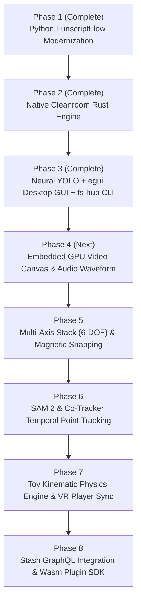

# Funscript Hub: Master Roadmap & Architectural Blueprint

> **The Unified, Open-Source, SOTA Funscript Generation, Precision Editing, and Haptic Playback Suite**  
> *Composed Monolith Architecture • Native-First Engine • Zero-Friction Ecosystem Bridges*

---

## 1. Executive Vision & Core Philosophy

**Funscript Hub (`fs-hub`)** is built to solve the fragmentation, high technical friction, and proprietary paywalls currently plaguing the haptic automation ecosystem. 

Rather than a fragile collection of external Python scripts or disconnected tools, Funscript Hub is designed as a **Composed Monolith**:
- **Native-First, Pure Rust Core**: High-speed, data-parallel, zero-runtime-dependency engine running in a unified process memory space with zero IPC serialization latency.
- **Separation of Duties, Unified Workflow**: Context-driven workspaces tailored to the task at hand—from precision keyframe authoring to distraction-free cinema playback and headless batch library processing.
- **Ecosystem Bridges**: Native implementations of every engine, alongside zero-friction bridges to community champions (**OpenFunscripter**, **MultiFunPlayer**, **Stash**, **HereSphere**, **DeoVR**).

```
┌─────────────────────────────────────────────────────────────────────────────────────────────┐
│                                FUNSCRIPT HUB (fs-hub)                                       │
│                                  Composed Monolith                                          │
├───────────────────────────────┬───────────────────────────────┬─────────────────────────────┤
│         GUI & UX LAYER        │         CLI RUNNER            │       API / BRIDGES         │
│  egui + WGPU Native Canvas    │  fs-hub generate/doctor/fix   │ HereSphere / Stash / MFP    │
├───────────────────────────────┴───────────────────────────────┴─────────────────────────────┤
│                                 ORCHESTRATION ENGINE                                        │
│                  Mode Switching: Studio (F1) / Cinema (F2) / Library (F3)                   │
├───────────────────────┬───────────────────────┬───────────────────────┬─────────────────────┤
│      fs-player        │       fs-editor       │       fs-vision       │       fs-sync       │
│  Hardware Video &     │  Multi-Axis Timeline, │  YOLO ONNX, SAM 2,    │  T-Code v0.2/v0.3,  │
│  PCM Audio Waveforms  │  Snapping, Undo/Redo  │  Optical Flow, Pose   │  Serial & UDP Sync  │
├───────────────────────┴───────────────────────┴───────────────────────┴─────────────────────┤
│                                     fs-core                                                 │
│       Funscript Schema, Script Doctor Linter, Toy Kinematics Model, Math & Signal           │
└─────────────────────────────────────────────────────────────────────────────────────────────┘
```

---

## 2. Competitive Landscape & Benchmark Targets

| Capability | OpenFunscripter (OFS) | FunGen 2 | MultiFunPlayer (MFP) | **Funscript Hub (`fs-hub`)** |
| :--- | :--- | :--- | :--- | :--- |
| **Architecture** | C++ / Qt5 | Python / PySide (Closed) | C# / .NET / WPF | **Native Rust (`egui` + WGPU)** |
| **Primary Focus** | Manual Keyframe Editor | Automated AI Tracking | Player & Haptic Router | **All-in-One Composed Suite** |
| **Tracking Model** | Basic OpenCV (CSRT/KCF) | YOLOv12n (Token/Paywalled) | None | **SAM 2 + Co-Tracker + YOLOv12n** |
| **Axis Support** | Multi-Axis (Manual) | 1D Stroke Only | Multi-Axis Routing | **Automated 6-DOF Multi-Axis** |
| **Processing Speed** | N/A | ~1x Realtime (Python) | N/A | **15x–30x Realtime (TensorRT/DirectML)** |
| **Quality Audit** | Basic Lua Scripts | None (Black box) | None | **Script Doctor & Physics Engine** |
| **Media Engine** | MPV Embedded | Local / Webview | Player Sync Receiver | **Zero-Copy Video + Audio Waveforms** |
| **Licensing** | GPL-3.0 | Proprietary Commercial | Open Source (GPL-3.0) | **Open Cleanroom (MIT / Apache-2.0)** |

---

## 3. The 3 Workplace Modes (Separation of Duties)

Keyboard shortcuts (`F1`, `F2`, `F3`) allow instantaneous context transitions without opening multiple applications:

```
[ F1: Studio Editor ] ────── [ F2: Cinema Player ] ────── [ F3: Batch Library ]
```

### Mode 1: Studio Editor (`F1`) — Precision Scripter's Cockpit
Designed for creators crafting, reviewing, or fine-tuning funscripts.
- **Embedded Synchronized Video**: Video frame locked to the playhead scrubber with frame-stepping jog controls.
- **AI Visual Overlay (Hotkey `V`)**: Real-time rendering of anatomical bounding boxes and tracked interaction points.
- **Multi-Axis Stacked Canvas**: Independent or grouped editing of $L_0$ (Stroke), $L_1$ (Surge), $L_2$ (Sway), $R_1$ (Pitch), and $V_0$ (Suction).
- **Audio Waveform Display**: Multi-resolution PCM audio energy waveform with transient peak detection.
- **Magnetic Snapping**: Automatically snaps keyframes to audio slaps/beats, discrete video frame boundaries, or inflection peaks.
- **Multi-Keyframe Transformations**: Box/lasso selection, proportional time stretch/compress, amplitude scaling, and inversion.
- **Procedural Pattern Infill**: Generates periodic sine/triangle/sawtooth strokes between selected anchors.
- **Unlimited Undo/Redo**: Bulletproof state history (`Ctrl+Z`, `Ctrl+Y`).
- **Live Script Doctor Heatmap**: Transition lines color-coded by motor velocity vectors ($> 450 \text{ units/s}$ in bright red).

### Mode 2: Cinema Player (`F2`) — Immersive Playback & Device Sync
Designed for distraction-free content consumption and hardware actuation.
- **Edge-to-Edge Video Canvas**: Hardware-accelerated zero-copy video decoding at native display refresh rates (60–144Hz).
- **VR 180 Stereo Mode**: Native side-by-side (SBS) projection with interpupillary distance and barrel distortion correction.
- **Sub-Millisecond A/V/H Sync**: Audio-visual-haptic clock synchronization with dynamic offset tuning hotkeys (`[` and `]` for $\pm 10\text{ms}$).
- **Auto-Hiding HUD**: Floating, translucent status indicator showing device telemetry, connection health, and playback scrubber.
- **On-The-Fly Range Clamping**: Global stroke range limiters (e.g., restrict physical movement to $15\% \to 80\%$) for safety during intense scenes.

### Mode 3: Batch Library Hub (`F3`) — Automation Pipeline & Server Integration
Designed for cataloging and mass generation.
- **Background Queue Manager**: Multi-threaded queue processing entire video directories without UI lag.
- **Stash Media Server Integration**: Native GraphQL connector (`localhost:9999`) that queries scenes missing scripts, batch-generates funscripts, and links them automatically.
- **Global Script Doctor Batch Repair**: One-click scan and repair across hundreds of funscripts to eliminate speed violations, micro-jitters, and timing inversions.

---

## 4. Subsystem Architectural Requirements

### `fs-player` (Video & Audio Engine)
- Zero-copy hardware frame decoding (FFmpeg pipe / VAAPI / NVDEC / Direct3D11 / VideoToolbox).
- Multi-speed pitch-preserved playback ($0.25\times, 0.5\times, 0.75\times, 1.0\times, 1.25\times, 1.5\times, 2.0\times$).
- A/B section looping for rhythm analysis.
- Multi-channel audio extraction and multi-resolution RMS peak overview generation.

### `fs-editor` (Timeline & Manipulation)
- Coordinate transformations ($X \leftrightarrow \text{ms}$, $Y \leftrightarrow \text{pos}$).
- Interactive hit-testing with multi-select drag, scale, and stretch handles.
- Magnetic snapping to audio transience, frame boundaries, and grid subdivisions.
- Procedural math macros (sine wave generator, smooth spline interpolation).

### `fs-vision` (AI Neural & Motion Engine)
- Ultralytics YOLOv12n inference pipeline (`ort`) with 10 anatomical classes.
- Temporal point tracking via Segment Anything Model 2 (SAM 2) and Co-Tracker memory banks to eliminate occlusion drift.
- Dense optical flow via multi-threaded Rayon Lucas-Kanade.
- 3D anatomical pose estimation: calculates surface unit normals for 6-DOF multi-axis generation ($L_0, L_1, L_2, R_0, R_1, R_2, V_0$).

### `fs-sync` (Hardware Protocol & Kinematic Simulation)
- T-Code v0.2 and v0.3 command formatter and parser.
- Dual UDP broadcast (`127.0.0.1:8888`) and direct Serial USB COM port streaming.
- **Physical Toy Kinematics Engine**: Calibrated motor models for The Handy, OSR2, SR6, and Keon.
- **Jerk-Limited S-Curve Smoothing**: Automatically adjusts sharp keyframe corners into jounce-minimized S-curves to protect physical servos.
- Thermal throttling prediction and automatic micro-cooldown compensation.

### `fs-bridges` (Community Tool Integrations)
- **OpenFunscripter Bridge**: Instant "Open in OFS" export action passing video and script to existing OFS installations.
- **MultiFunPlayer Bridge**: Real-time UDP/WebSocket broadcast supporting MFP's custom output routing.
- **VR Headset API**: Native local WebSocket server for zero-config auto-discovery by **HereSphere VR**, **DeoVR**, and **Whirligig**.
- **Stash API**: Direct GraphQL connection for automated media server library synchronization.

---

## 5. Phased Implementation Roadmap



### ✅ Phase 1: Python Modernization (Completed)
- [x] Dual photometric $L_1$ and polar flow cut detection.
- [x] Unified 30 FPS frame stepping and temporal median center filtering.
- [x] Cross-platform OS openers and persistent process pool.
- [x] Automated pytest test suite (10/10 passing).

### ✅ Phase 2: Native Rust Cleanroom Engine (Completed)
- [x] High-performance pure Rust engine (`open-fungen`).
- [x] Zero-C-binding hardware FFmpeg raw frame pipe streaming.
- [x] Rayon multi-threaded Lucas-Kanade dense optical flow.
- [x] 2D divergence center tracking, POV bottom anchor, and VR 180 stereo cropping.
- [x] Overlapping Hanning polynomial detrending and rolling min-max normalization.
- [x] Script Doctor quality audit linter.

### ✅ Phase 3: Neural ONNX YOLO & Unified Hub GUI (Completed)
- [x] Ultralytics YOLOv12n inference pipeline (`ort`) with 10 anatomical classes.
- [x] Organ distance penetration tracker with hybrid optical flow fallback.
- [x] Interactive `egui` desktop timeline canvas with zoom, pan, and keyframe dragging.
- [x] Real-time Script Doctor linter sidebar and one-click batch repairs.
- [x] Unified `fs-hub` CLI binary and PATH symlink installer (`install.sh`).
- [x] Automated Rust unit & integration test suite (18/18 passing).

---

### ⏳ Phase 4: Embedded Video Frame Canvas & Multi-Band Audio Waveform (Next Up)
- [ ] **Embedded Video Frame Surface**: Render synchronized decoded video frames directly inside the Studio Editor and Cinema Player modes.
- [ ] **Frame Stepping Controls**: True single-frame forward/backward steps, 5-frame jog, and keyframe jump hotkeys.
- [ ] **Audio Waveform Pipeline**: Extract PCM audio via FFmpeg and generate multi-resolution RMS overview buffers.
- [ ] **Audio Waveform Renderer**: Draw anti-aliased audio waveforms aligned to millisecond timecodes beneath the timeline curve.
- [ ] **Hardware Acceleration Backend Selector**: GUI settings to enable CUDA / TensorRT / DirectML / CPU inference providers.

---

### ⏳ Phase 5: Multi-Axis Timeline (6-DOF) & Magnetic Snapping
- [ ] **Multi-Track Funscript Schema**: Support concurrent tracking and editing for $L_0$ (Stroke), $L_1$ (Surge), $L_2$ (Sway), $R_0$ (Roll), $R_1$ (Pitch), $R_2$ (Twist), and $V_0$ (Suction).
- [ ] **Stacked vs. Overlay Track Views**: Toggle between separate vertical axis lanes and unified multi-colored overlay.
- [ ] **Magnetic Audio Transient Snapping**: Automatically snap keyframe peaks to audio slaps, vocalizations, and rhythmic drum beats.
- [ ] **Multi-Keyframe Selection Transformations**: Box-select, time stretch/compress handles, amplitude scaling, and inversion.
- [ ] **Procedural Infill Generators**: Sine wave, triangle wave, and sawtooth infill macros between selected markers.

---

### ⏳ Phase 6: SOTA Neural Vision (SAM 2 & Temporal Point Tracking)
- [ ] **SAM 2 / Co-Tracker Memory Integration**: Persistent point tracking across video frames to prevent occlusion drift.
- [ ] **3D Anatomical Pose Estimator**: Extract organ 3D spatial orientation and penetration vectors from surface landmarks.
- [ ] **Automated 6-Axis Generator**: Simultaneously generate $L_0, L_1, L_2, R_1$ funscripts from a single video pass.
- [ ] **Scene Boundary Classification**: Automatic semantic tagging of position transitions, rhythm changes, and cut boundaries.

---

### ⏳ Phase 7: Toy Kinematic Physics Engine & VR Player Sync
- [ ] **Physical Motor Dynamics Models**: Calibrated profiles for The Handy, OSR2+, SR6, and Keon.
- [ ] **Jerk-Limited S-Curve Filter**: Automatic conversion of sharp linear corners into jounce-minimized mechanical curves.
- [ ] **Thermal & Wattage Protection**: Real-time continuous power estimation with micro-cooldown valley insertion.
- [ ] **HereSphere & DeoVR WebSocket Server**: Built-in zero-config local network discovery and real-time playback sync.
- [ ] **VR 180 SBS Player Mode**: Native stereo split-screen viewport with barrel distortion correction.

---

### ⏳ Phase 8: Stash Media Automation & Wasm Plugin Ecosystem
- [ ] **Stash GraphQL Integration**: Automated scanning of local Stash libraries (`localhost:9999`), headless batch script generation, and metadata tagging.
- [ ] **Wasm / Lua Plugin SDK**: Sandboxed runtime allowing community creators to author procedural generation macros and curve filters.
- [ ] **Cross-Platform Release Packaging**:
  - Linux: Native binary, AppImage, Flatpak, AUR package.
  - Windows: Portable single `.exe` and setup installer.
  - macOS: Universal Apple Silicon & Intel DMG.

---

## 6. Verification & Quality Gates

Every phase adheres to strict automated testing and validation standards:
1. **Zero Regression Policy**: All existing tests (signal detrending, optical flow, YOLO tensor normalization, NMS, Script Doctor linter) must pass on every build.
2. **Deterministic Outputs**: Given the same video and seed parameters, signal integration and keyframe reduction must produce byte-identical `.funscript` files.
3. **Hardware Safety Guarantee**: All generated scripts pass Script Doctor linter rules ($< 450 \text{ units/s}$, zero inversions, zero micro-jitters) before saving.
